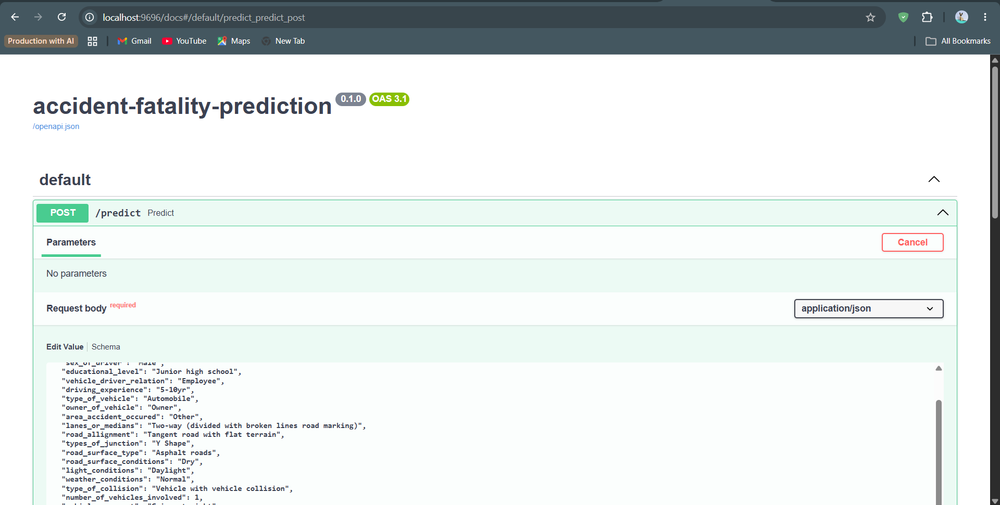
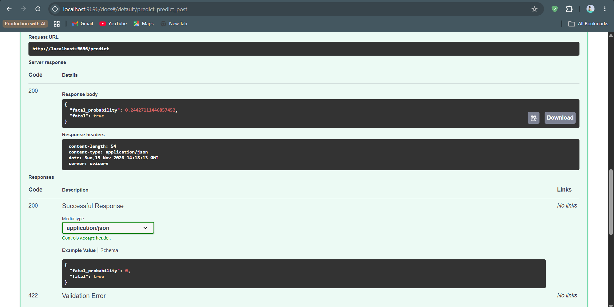

# Road Accident Fatality Prediction

## Project Overview

Road traffic accidents are a major public safety concern, and understanding the factors associated with accident severity can help improve road safety analysis.

This project focuses on predicting whether a road traffic accident is fatal or non-fatal using machine learning. The objective is to estimate the likelihood of a fatal outcome once an accident has occurred, based on information about the accident, the road environment, vehicles involved, and drivers.

The project follows an end-to-end machine learning workflow, covering exploratory data analysis (EDA), data preprocessing, feature selection, model training, hyperparameter tuning, and model evaluation.

Several classification algorithms like a baseline Logistic Regression model, Decision Tree Classifier, Random Forest Classifier, XGBoost were explored and compared, with XGBoost selected as the final model based on its performance.

The selected model is served through a FastAPI web service, allowing users to submit accident details and receive a predicted fatality probability and classification. The prediction threshold is set to 0.10 according to the tested thresholds in the notebook.

## Models and Evaluation

Four classification models were trained and evaluated using ROC-AUC on the validation set.

| Model               | Validation ROC-AUC |
| ------------------- | -----------------: |
| Logistic Regression |              0.589 |
| Decision Tree       |              0.605 |
| Random Forest       |              0.644 |
| XGBoost             |          **0.684** |

XGBoost achieved the highest validation ROC-AUC and was selected as the final model.

### Hyperparameter Tuning

Several rounds of hyperparameter tuning were carried out on the XGBoost model, focusing on `max_depth`, `eta` (learning rate), and `min_child_weight`.

The following combination produced the best result:

| Hyperparameter     | Selected value |
| ------------------ | -------------: |
| `eta`              |            0.1 |
| `max_depth`        |             12 |
| `min_child_weight` |              1 |

These values were used for the final XGBoost model.

### Test Set Performance

On the test set, using a classification threshold of 0.10, the model achieved:

| Metric    | Fatal class (1) |
| --------- | --------------: |
| Precision |            0.23 |
| Recall    |            0.71 |
| F1-score  |            0.35 |

The model identified 71% of fatal accidents in the test set, although its precision indicates that some non-fatal accidents were also classified as fatal.

## Dataset

The dataset used in this project is the [Road Accidents Severity Dataset](https://www.kaggle.com/datasets/kanuriviveknag/road-accidents-severity-dataset), sourced from Kaggle.

The dataset contains road traffic accident records from Addis Ababa, Ethiopia, covering the period 2017–2020.

### Downloading the dataset from Kaggle

1. Visit the [Kaggle dataset page](https://www.kaggle.com/datasets/kanuriviveknag/road-accidents-severity-dataset).
2. Sign in to your Kaggle account.
3. Click **Download** to download the dataset.
4. Extract the downloaded files.
5. Place the required CSV file in your project directory before running the notebook.

### Downloading the dataset from GitHub

The raw dataset is also available directly in this repository as [`RTA_Dataset.csv`](./RTA_Dataset.csv).

1. Open the dataset file in the repository.
2. Click **Download raw file**.
3. Place the downloaded CSV file in your project directory before running the notebook.

## Project Structure

```text
ML-zoomcamp-mid-term-project/
│
├── data/
├── src/
├── images/
├── notebook.ipynb
├── RTA_Dataset.csv
├── model.bin
├── predict.py
├── Dockerfile
├── pyproject.toml
├── uv.lock
├── .python-version
└── README.md
```

## Getting Started

### 1. Clone the repository

```bash
git clone https://github.com/AbdulrahmanGidado/ML-zoomcamp-mid-term-project.git
cd ML-zoomcamp-mid-term-project
```

### 2. Install uv

Follow the official installation guide:

[https://docs.astral.sh/uv/getting-started/installation/](https://docs.astral.sh/uv/getting-started/installation/)

### 3. Install project dependencies

```bash
uv sync --locked
```

## Running the API

Start the FastAPI service:

```bash
uv run uvicorn predict:app --host 0.0.0.0 --port 9696
```

## Testing the API

Open the FastAPI documentation in your browser:

[http://127.0.0.1:9696/docs](http://127.0.0.1:9696/docs)

### FastAPI Documentation



### API Prediction Response



1. Expand the `/predict` endpoint.
2. Click **Try it out**.
3. Enter the accident details in JSON format.
4. Click **Execute** to receive a prediction.

The API returns:

- `fatal_probability`: The predicted probability of a fatal accident.
- `fatal`: A Boolean classification. Predictions with a probability of 0.10 or higher are classified as fatal.

## Running with Docker

### 1. Build the Docker image

```bash
docker build -t accident-severity .
```

### 2. Run the Docker container

```bash
docker run -it --rm -p 9696:9696 accident-severity
```

### 3. Access the API

Open:

[http://localhost:9696/docs](http://localhost:9696/docs)

You can now test the prediction endpoint through the FastAPI documentation interface.
